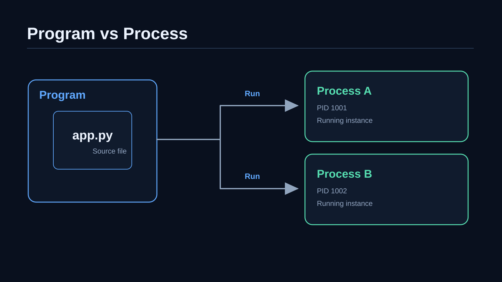
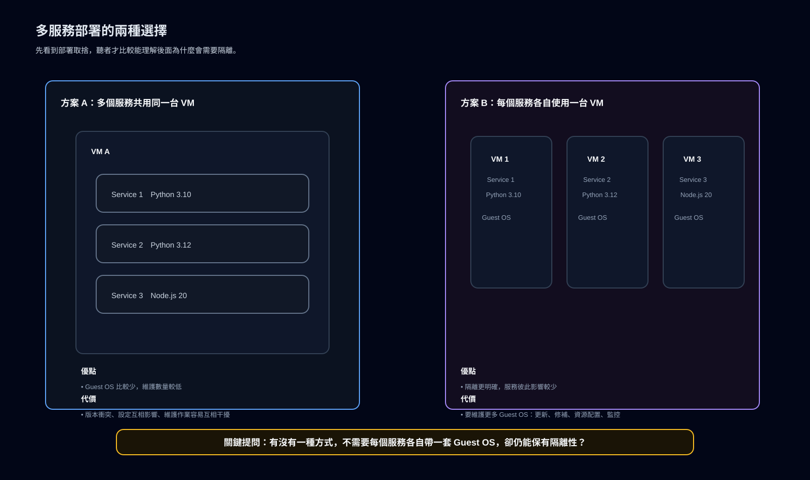
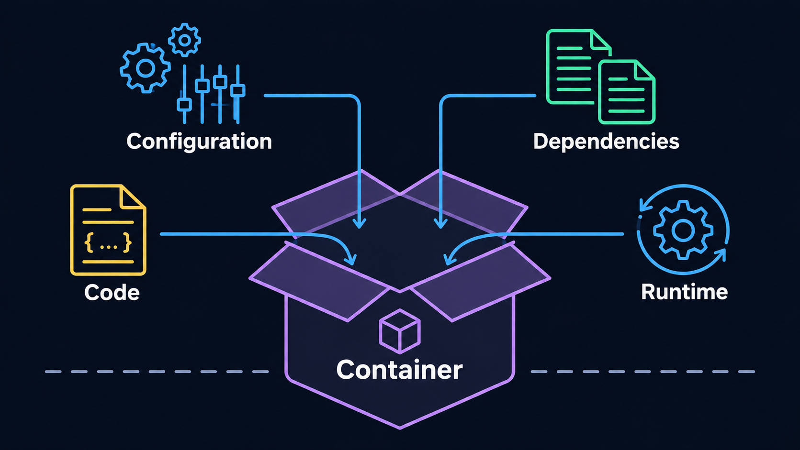
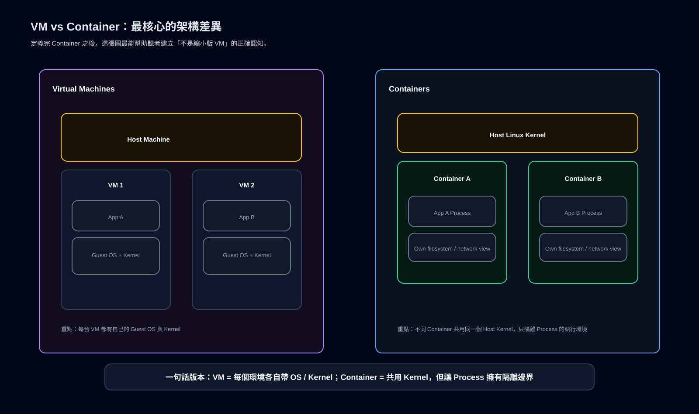
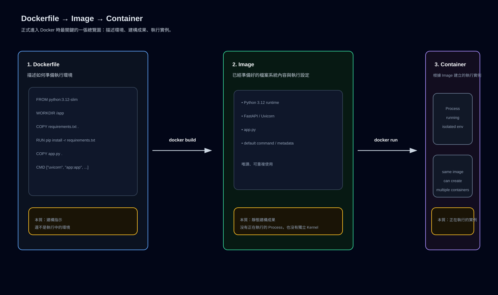
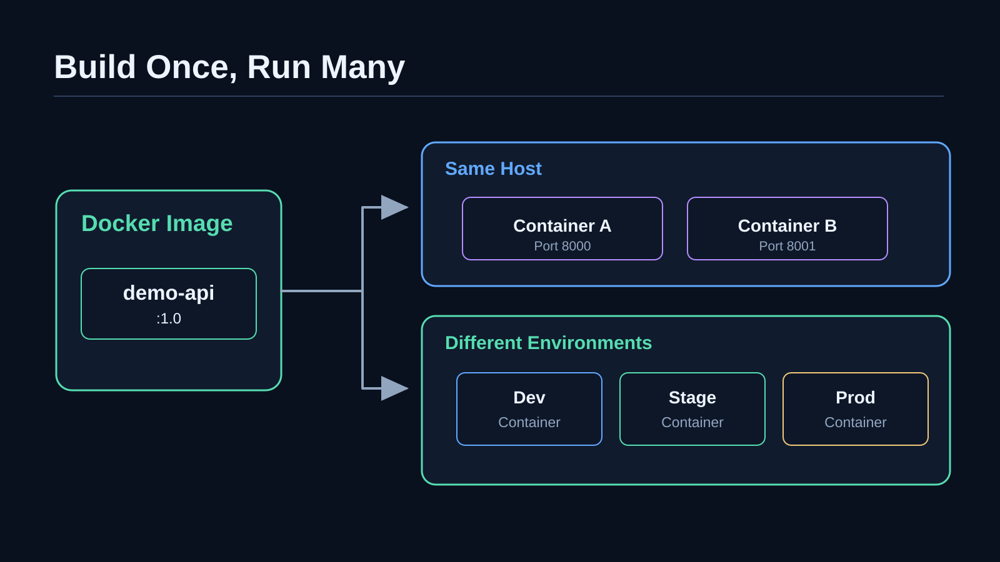

# Docker Fundamentals — 口頭教學逐字稿

> **用途：**記錄討論後、已經確認可用於實際分享的口頭教學講稿。每次確認新段落後，持續更新本檔案；尚未確認的內容不預先寫入。
>
> **對象：**具備基本程式開發經驗的工程師。
>
> **目前進度：**Lesson 01 逐字稿已完成、已確認並依四個 Chapter／十三個 Section 重整；Dockerfile／Image／Container 基本教學及最小實作示範均已納入，尚待實機驗證與正式教材排版。
>
> **課程結構決議（2026-11-22）：**取消獨立的 Why Containerization，原八堂調整為七堂。Session 01 整合必要的 Why；Session 02 改為 How Containers Work。此決議不代表後續尚未確認的口頭講稿已完成。
>
> **最近修訂：**2026-11-25（2.1 改用使用者於對話中確認的 PNG 原圖；保留四條箭頭與開口紙箱構圖）

---

## 教材結構與視覺資源備註（非口頭逐字稿）

- **2026-11-25 連貫性修訂（已依使用者回饋套用）**：1.1 從程式內容如何成為執行實例帶出同一 Program 可被多次執行，不突然插入 PID／記憶體術語；1.3 只留下「服務互不干擾是否一定要各自 Guest OS？」的需求問題，不提尚未說明的 Kernel；2.1 直接承接問題並定義 Isolation，不重新追問為何要分 VM；2.2 才首次以「作業系統核心」介紹 Kernel。五張 Dark Mode SVG 全部改為英文、僅顯示實際技術關係，沒有講者提示語。

- **整套課程：Docker Fundamentals**，規劃共七堂 Lesson；Lesson 是一堂完整教學，不等於 Chapter。**Lesson 01 — Introduction to Containers & Docker**，內含四個 Chapter，每章可有多個 Section，以章內編號（如 1.1、1.2、2.1）標識，不再在 Section 下增加第三層教學標題。
- **Chapter 1 — From Program to Deployment**：1.1 Program vs Process → 1.2 Application Execution Environment → 1.3 Traditional Deployment & VM Trade-offs。從執行的基本單位帶出 Runtime／Dependencies，再說明共用 VM 和多 VM 的部署取捨。
- **Chapter 2 — Understanding Containers**：2.1 Why Isolation Matters → 2.2 What Is a Container? → 2.3 VM vs Container。先建立隔離需求，再定義 Container 是一個或一組受隔離的 Process，最後比較 VM 獨立 Guest Kernel 與 Container 共用 Host Kernel。
- **Chapter 3 — Understanding Docker**：3.1 Why Docker? → 3.2 Dockerfile — Defining the Environment → 3.3 Docker Image — The Build Artifact → 3.4 Docker Container — Running the Application。從環境準備仍存在的需求引出 Docker，再依序理解建構指示、靜態成果、執行實例。
- **Chapter 4 — Hands-on & Key Takeaways**：4.1 Building a Docker Image → 4.2 Running Multiple Containers → 4.3 Putting It All Together。先展示三個實作檔案與 Image Build，再啟動兩個 Container 並清理，最後呼應 Program／Process 類比與 Build Once, Deploy Many。
- **講稿原則**：Chapter／Section 標題是講稿及教材導覽層級，不硬塞「現在進入第二章／下堂再談」進口語。此次僅重編已確認段落、將原本的 Docker 概念教學與最小實作依主題歸類，保留先前核准的敘述、示範指令及自然 Bridge。課程章次與順序日後可以調整，口語稿不得依賴預告下堂才能完成收尾。
- **六張圖資已上傳並嵌入逐字稿（Dark Mode，2.1 採原圖 PNG，其餘 SVG）**：圖 01 Program vs Process → 1.1；圖 02 Shared VM vs Multiple VMs → 1.3；圖 02B Container 開箱示意（原圖版型、Configuration／Dependencies／Code／Runtime Engine 四條箭頭 → Container）→ 2.1 結尾；圖 03 VM vs Container Architecture → 2.3；圖 04 Dockerfile → Image → Multiple Containers（獨立 Main Processes）→ 3.4；圖 05 Build Once, Run Many / Deploy Many → 4.3。深色底、維持原本藍／綠／紫／黃配色；學員版圖面不應包含講師備註、編排理由、無關的描述，且應檢查繁體中文顯示、箭頭方向、元件比例與可讀性。
- **其他 Lesson 仍依原本七堂大綱規劃**：Lesson 02 — How Containers Work；Lesson 03 — Dockerfile & Image Internals；Lesson 04 — Docker Builds & Best Practices；Lesson 05 — Container Lifecycle & Storage；Lesson 06 — Docker Networking；Lesson 07 — From Docker to Kubernetes。Lesson 01 的核心比較不提前深入 Namespaces／cgroups／OCI／BuildKit 等實作。
- **完成狀態**：本檔已確認講述內容與最小實作流程；尚未完成 Docker 實測、整堂試講時間評估，正式 HTML 教材仍未更新；但五張 Dark Mode SVG 已上傳至 `Docker/assets/diagrams/`，並以相對路徑嵌入對應的逐字稿 Section。

---

## Lesson 01 — Introduction to Containers & Docker

---

### Chapter 1 — From Program to Deployment


#### 1.1 Program vs Process


**狀態：已確認**

今天我們要開始 Docker Fundamentals，但在講 Docker 跟 Container 之前，我想先從大家每天都在做的事情開始：執行程式。

假設你寫了一支 Python API，檔名叫 `app.py`，放在電腦硬碟裡面，這時候它其實還沒有在跑，它只是靜靜躺在那裡的程式內容，我們叫它 Program。

那什麼時候它才真的動起來呢？

當你打開 Terminal，輸入 `python app.py`，作業系統就會啟動 Python Interpreter 來執行這份程式。這個時候，出現的不是另一份 `app.py` 檔案，而是一個由作業系統管理的執行實例，也就是 **Process**。

如果這支程式會持續運作，我們也可以再啟動一次。同一份程式內容，就能對應到兩個不同的執行實例；增加的是執行中的 Process，而不是多出另一份程式檔案。

所以這裡先記住兩者的差別：**Program 是程式內容，Process 是程式被執行時的實例。**

<!-- 圖 01｜Section 1.1｜Dark Mode｜插入時機：介紹 Program 與 Process 的差異後，進入部署情境之前 -->




#### 1.2 Application Execution Environment
好，接下來把情境拉回大家熟悉的工作：你在自己電腦上把一支 FastAPI 寫好，跑起來沒問題，現在公司要你把它放到一台 Linux Server，你會怎麼做？

傳統作法可能是在一台 VM 上準備好正確版本的 Python、安裝需要的套件、設定環境變數，最後把程式啟動。

這樣當然可以，也可以用自動化工具幫忙，但重點是：一支程式能不能跑，不只取決於程式碼，還取決於 Runtime、Dependencies、Configuration，還有系統提供的各種條件。

如果同一台主機上要放多個服務，而且版本跟需求不同，我們還得思考怎麼管理它們各自的執行環境，以及怎麼避免彼此影響。

所以，服務能不能跑是一回事；當服務變多，該怎麼安排它們各自的執行環境，又是另一個需要考慮的問題。


#### 1.3 Traditional Deployment & VM Trade-offs


**狀態：已確認（本節為進入 What Is a Container 前的橋樑）**

假設公司今天不只有一支 API，而是有十個服務，而且每個服務需要的版本都不一樣。這些服務要怎麼部署？

我們可以把它們全部放在同一台 VM，也可以選擇一個服務使用一台 VM。

如果放在一起，我們就得小心管理不同服務的環境，避免套件、設定或維護作業互相影響。

如果分開放，不同服務之間就可以有更明確的隔離。但我們也從原本管理一台 VM，變成可能要管理十台 VM、十套 Guest OS。

每套 Guest OS 都需要更新、安全修補、資源配置和維護。當服務數量越來越多，這些管理成本和工作量也可能跟著增加。

所以你會發現，不管選哪一種做法，都有取捨。

把服務放在一起，可以減少需要管理的作業系統數量，但要處理環境互相干擾的問題；把服務分開，可以取得更明確的隔離，卻可能需要維護更多套 Guest OS。

<!-- 圖 02｜Section 1.3｜Dark Mode｜插入時機：講完兩種部署方案的成本與隔離取捨後，提出 Guest OS 必要性問題之前 -->



這兩種選擇，其實都圍繞著同一個需求：我們希望不同服務能各自運作，盡量不要因為其他服務調整環境而受到影響。

**那麼，要達到這種彼此不干擾的效果，真的一定要為每個服務準備一套獨立的 Guest OS 嗎？**


---

### Chapter 2 — Understanding Containers


#### 2.1 Why Isolation Matters


**狀態：已同意納入逐字稿，結尾措辭仍可再微調**

不一定。VM 是隔開服務的一種方法，但剛才看到的維護成本，也正是我們希望尋找其他做法的原因。

先想想，所謂「服務之間不要互相影響」，具體是什麼意思？

例如，A 服務更新套件或調整設定時，不應直接改變 B 服務的執行環境；其中一個服務占用大量資源，也不應毫無限制地影響其他服務。

**讓不同服務在各自的執行邊界內運作，降低彼此干擾，這個需求就叫做隔離性（Isolation）。**

<!-- 圖 02B｜Section 2.1｜Dark Mode PNG｜插入時機：完成 Isolation 定義後；使用對話中核准的原圖 PNG，四條箭頭匯入標示 Container 的紙箱 -->




#### 2.2 What Is a Container?
那麼，除了讓每個服務使用不同 VM，還有沒有其他方式能建立這樣的隔離邊界？

我們先回到一開始介紹的 Process。

在 Linux 裡，負責管理 Process 與系統資源的作業系統核心，稱為 **Kernel**。Linux 本身也提供一些機制，可以控制不同 Process 能夠看到、存取和使用哪些系統資源。

例如，可以讓某一群 Process 看到特定的檔案系統環境，使用自己的網路環境，或限制它們能夠使用的運算資源。

重點是，我們不需要為了實現這些隔離，就額外啟動一整套 Guest OS。

這些 Process 依然共用同一個 Linux Kernel，只是各自運作在具有特定隔離邊界的環境當中。

而透過這些 Linux 機制所建立的隔離執行環境，就是我們今天要認識的 **Container，也就是容器**。

那講到這裡，我想特別強調一件事。

我們在網路上的架構圖，常常看到一個方框寫著 Container，裡面放 Application、Libraries。這很容易讓人以為 Container 是一個小盒子，程式被裝進去之後才開始執行。

**但從 Linux 的角度來看，Container 本質上仍然是一個或一組受到隔離機制約束的 Process。**

它們不是另一套獨立的作業系統，仍然由 Host 的 Linux Kernel 負責執行。


#### 2.3 VM vs Container


**狀態：已確認納入（2026-11-24；基礎對照，不深入 Hypervisor／Namespace／cgroups 實作）**

這裡可以順著剛才的情境，回頭比較一下 VM 跟 Container 到底差在哪裡。

前面說過，如果服務分別部署到不同 VM，就可能需要維護多套 Guest OS。為什麼換成 Container，就不需要為每個服務再準備一套？

先看 VM。一般的 VM 是透過 Hypervisor 提供虛擬化的硬體環境，讓每台 VM 都能執行自己的 Guest OS，包括自己的 Kernel。兩個服務如果分別執行在兩台 Linux VM 裡，背後就有兩套獨立的 Linux Kernel。

Container 則不同。在同一台 Linux 主機上，即使兩個 Container 能看到不同的檔案系統、使用各自的網路環境，裡面執行的仍然是 Host Kernel 管理的 Process。**它們共用同一個 Linux Kernel，而不是各自啟動一套新的 Guest OS。**

這就是兩者最核心的架構差異：**VM 透過各自的 Guest OS 與 Kernel 建立執行環境；Container 則是在共用 Kernel 的前提下，為 Process 建立隔離邊界。**

<!-- 圖 03｜Section 2.3｜Dark Mode｜插入時機：VM 與 Container 的 Kernel 差異說明完畢後 -->



也因為不必為每個 Container 額外啟動 Guest OS，Container 通常更輕量，啟動也通常比較快。不過，兩者的隔離邊界不同；VM 通常能提供更強的隔離，但實際安全性仍取決於設定與使用情境。

所以 Container 並不是縮小版的 VM，而是另一種讓不同服務擁有隔離執行環境的方式。


---

### Chapter 3 — Understanding Docker


#### 3.1 Why Docker?


**狀態：已確認（What Is Docker 開場橋樑；Dockerfile／Image／Container 的基本介紹已接續於 3.2–3.4；Registry 等深入細節不在本段）**

從剛才的比較可以發現，Container 讓我們不一定需要為每個服務都準備獨立的 VM，也能建立隔離的執行環境。

但有了隔離，應用程式就能直接執行了嗎？

回到我們一開始部署 Python API 的情境。

即使現在可以建立 Container，**我們的應用程式依然需要 Python Runtime、Dependencies，以及必要的設定，才能正常執行。**

換句話說，Container 幫我們建立了隔離的執行環境，但不代表這個環境裡面就自動具備了應用程式需要的所有東西。

所以工程師依然得準備這些內容。

假設今天有十個服務，我們可能需要替它們準備不同版本的 Runtime、安裝各自需要的 Dependencies，再設定程式的啟動方式。

你會發現，這其實跟我們前面在 VM 上部署應用程式的情境，有一個很相似的地方。

雖然我們現在不一定需要替每個服務建立獨立的 Guest OS，**但應用程式執行環境的準備與管理工作，依然存在。**

當然，這些工作可以透過腳本和既有工具來自動化。

但如果今天我們希望同一份已經準備好的執行環境，可以很容易地重複使用，甚至能建立多個相同的執行實例呢？

那麼，我們就不只需要 Container 的隔離能力。

我們還需要一套方便、標準化的方式，來描述、建構及管理這些執行環境。

**而這正是 Docker 帶來的重要價值。**

Docker 並沒有重新發明 Container 的隔離機制，而是整合既有的容器技術，並提供 Image 建構、Container 管理等工具，讓工程師能更方便地準備與重複使用應用程式的執行環境。

而最直接能看出 Docker 如何做到這件事的，就是 Dockerfile、Image 和 Container 之間的關係。

> **教學範圍：**本段已確認的是從 Container 過渡到 Docker 的因果橋樑。先延續**同一台 Linux Server** 上多個服務的情境，說明隔離已可做到但 Runtime / Dependencies / Configuration 仍需準備。**不要在此處突然跳到其他 Server 的交付與部署**；跨主機交付及 Registry 的深入細節不在這段 Bridge 展開。


#### 3.2 Dockerfile — Defining the Environment


**狀態：已確認納入（2026-11-24；第一堂的概念教學，不深入 Image Layers、OCI、BuildKit）**

好，那 Docker 究竟是怎麼幫我們準備應用程式的執行環境呢？

我們再回到一開始那支 Python API。假設今天已經寫好一個 `app.py`，另外有一份 `requirements.txt`，記錄程式需要的 Python 套件。

還記得前面部署到 VM 時，需要先準備 Python Runtime、安裝 Dependencies，最後才能啟動應用程式嗎？

使用 Docker 之後，這些事情其實沒有消失。**我們只是多了一種可以明確描述、重複執行環境準備工作的方式：Dockerfile。**

大家看一下畫面上的 Dockerfile：

```dockerfile
FROM python:3.12-slim

WORKDIR /app

COPY requirements.txt .
RUN pip install --no-cache-dir -r requirements.txt

COPY app.py .

CMD ["uvicorn", "app:app", "--host", "0.0.0.0", "--port", "8000"]
```

第一行 `FROM python:3.12-slim`，代表我們選擇一份已經包含 Python 3.12 執行環境的 **Base Image** 作為建構起點，不需要從零開始準備 Python。

接下來用 `WORKDIR` 指定工作目錄，透過 `COPY` 把 `requirements.txt` 複製進去，再由 `RUN pip install` 安裝 FastAPI、Uvicorn 等 Dependencies。

安裝完成後，我們再把自己的 `app.py` 複製進去；最後，`CMD` 描述這份 Image 被用來啟動 Container 時，預設要執行哪個指令。以這支 API 為例，就是啟動 Uvicorn。

大家有沒有發現？**這些內容其實就是以前部署程式時，為了讓程式能夠執行而需要準備的事情。** 現在我們把它們寫成 Dockerfile，建構步驟就有了一份明確的描述。

不過，Dockerfile 本身只是**建構指示**，不是已經準備好的環境，也不是正在執行的 Container。

那要怎麼把這份指示變成可以使用的東西？


#### 3.3 Docker Image — The Build Artifact


接下來我們執行 `docker build`。Docker 會根據 Dockerfile 的指示，以 Python 3.12 的 Base Image 為基礎，安裝 Dependencies，再放入自己的程式碼。

這些內容建構完成後，得到的成果就叫做 **Docker Image**。

但講到這裡，我們應該先釐清：**Image 究竟是什麼東西？**

你可以先把 Docker Image 理解成**一份唯讀、可以重複使用的執行環境範本**。它包含應用程式需要的檔案系統內容，以及相關的執行設定。

以這支 Python API 來說，Image 可以包含 Python 3.12 的執行檔、系統 Libraries、FastAPI、Uvicorn、`app.py`，以及預設啟動指令等設定。

所以 Image 已經把應用程式需要的內容準備好了；但這時候，API 已經開始提供服務了嗎？

**還沒有。** Image 是靜態的建構產物，本身沒有正在執行的 Process。它也不是一套正在運作的 Guest OS，更不需要包含一個獨立的 Linux Kernel。

真正執行應用程式時，仍然由 Host 的 Linux Kernel 管理對應的 Process。這就能連回我們前面介紹的 Container：**Image 提供檔案與設定，Container 才是讓應用程式實際執行的實例。**


#### 3.4 Docker Container — Running the Application


當我們執行 `docker run`，Docker 就會根據指定的 Image 建立並啟動 Container，使用 Image 裡面的檔案與設定，執行預設的 Uvicorn 啟動指令。

這個時候，Python API 才真正開始執行，形成 Linux Process，並在 Container 的隔離執行環境中運作。

這裡還有一個很重要的差別：Dockerfile 裡面的 `RUN pip install` **是在建構 Image 時執行**；`CMD` 則是定義 Container 啟動時預設要執行的指令。

因此，**我們不需要每次啟動 Container，就重新安裝一次 Python 套件。** 這些檔案已經在建構 Image 時準備好了，可以用來建立不只一個 Container。

<!-- 圖 04｜Section 3.4｜Dark Mode｜插入時機：完成 Dockerfile、Image、Container 的介紹後，說明同一份 Image 可建立多個 Container，各有獨立的 Main Process，再進入 CLI 示範 -->



從「描述環境」到「建構成果」，再到「實際執行」，整個過程現在已經串起來了。我們直接用 Terminal 驗證一次。


---

### Chapter 4 — Hands-on & Key Takeaways


#### 4.1 Building a Docker Image


**狀態：已確認納入（2026-11-24；下列為可操作的示範規格與預期觀察，尚未在本次 GitHub 更新中實際啟動 Docker 驗證）**

**示範前提（講者準備；非口頭講稿）：**執行環境可使用 Docker CLI、連接到 Docker Engine、能取得 `python:3.12-slim` Base Image；`8000`、`8001` 兩個 Host Port 未被占用。以下指令在包含三個檔案的同一個目錄執行。

**app.py**

```python
from fastapi import FastAPI

app = FastAPI()

@app.get("/")
def hello():
    return {"message": "Hello Docker"}
```

**requirements.txt**

```text
fastapi
uvicorn
```

**Dockerfile**

```dockerfile
FROM python:3.12-slim

WORKDIR /app

COPY requirements.txt .
RUN pip install --no-cache-dir -r requirements.txt

COPY app.py .

CMD ["uvicorn", "app:app", "--host", "0.0.0.0", "--port", "8000"]
```

我們先執行：

```bash
docker build -t demo-api:1.0 .
```

這個指令會使用目前目錄當作 Build Context，依照裡面的 Dockerfile 建構出 `demo-api:1.0`。其中 `-t` 是替建構成果加上 Name／Tag，最後的 `.` 是目前目錄。

建構完成後，我們可以檢查 Image：

```bash
docker image ls demo-api
```

**預期觀察：**可以找到 `demo-api`、Tag 為 `1.0` 的 Image；此時應用程式還沒有因為 `docker build` 而開始提供 HTTP 服務。


#### 4.2 Running Multiple Containers


接著執行：

```bash
docker run -d --name api-a -p 8000:8000 demo-api:1.0
```

`-d` 表示在背景執行；`--name` 替 Container 命名；`-p 8000:8000` 表示把 Host 的 `8000` Port 對應到 Container 內的 `8000` Port。

用瀏覽器開啟 `http://localhost:8000/`。

**預期觀察：**HTTP 回傳 `{"message":"Hello Docker"}`。這證明應用程式已在 Container 內啟動，而不只是完成了 Image Build。

**同一份 Image，再建立第二個 Container**

我們不修改 Dockerfile，也不重新 Build，直接再執行：

```bash
docker run -d --name api-b -p 8001:8000 demo-api:1.0
docker ps
```

第二個 Container 的內部服務仍使用 `8000`，但對外映射到 Host 的 `8001`，避免與第一個 Container 的 Host Port 衝突。

用瀏覽器開啟 `http://localhost:8001/`。

**預期觀察：**同樣回傳 `{"message":"Hello Docker"}`；`docker ps` 可以看到 `api-a`、`api-b` 兩個正在執行的 Container，且 IMAGE 欄位都對應 `demo-api:1.0`。

**講者提問：**我們剛剛有重新執行 `docker build`，或重新安裝一次 FastAPI 嗎？沒有。兩個 Container 是以同一份 Image 為基礎，分別建立的執行實例。

**清理示範環境**

```bash
docker rm -f api-a api-b
```

這會停止並移除示範建立的兩個 Container；若需要連 Image 一起清理，可另外執行 `docker image rm demo-api:1.0`。

**教學邊界（非口頭講稿）：**只簡介本示範使用的基本 Flags，不提前講 Docker API／Daemon、BuildKit、Image Layer 實作、Network Namespace 或詳細 Lifecycle。示範的 `requirements.txt` 未固定套件版本，足夠展示基本機制，但不同時間重新 Build 可能解析到不同版本；若用於可重複性要求較高的正式環境，需另外固定 Dependencies 與 Base Image 版本／Digest。

**銜接口語：**「我們剛才實際用一份 Image 建立了兩個 Container。現在回頭看最一開始的 Program 與 Process，兩者之間就有一個很容易理解的類比。」


#### 4.3 Putting It All Together


**狀態：已確認（2026-11-22；2026-11-24 已補入完整概念講述與示範，已接續 4.1–4.2 的實作示範）**

最後，我們把剛才一路建立的幾個觀念串起來。

我們一開始從 Program 和 Process 出發，知道同一份 Program 可以被執行很多次，產生不同的 Process。

現在回頭想想，我們剛剛也說過，**Container 本質上仍然是一個或一組受到隔離機制約束的 Linux Process**。

所以這裡其實可以用一個很相似的方式來理解。

就像同一份 Program 可以啟動多個 Process 一樣，**同一份 Docker Image，也可以拿來建立並啟動多個 Container**。

例如，剛剛那支 Python API，我們只需要先建構好一份 Image，就可以根據同一份 Image 建立 Container A、Container B，讓它們各自執行。

不需要為了每建立一個 Container，就重新執行一次安裝 Python 和 Dependencies 的建構步驟。

不過，這個類比是為了理解「一份內容可以建立多個執行實例」，不是說 Image 完全等於 Program，或 Container 完全等於單一 Process。

Image 還包含建構好的檔案系統內容與執行設定；Container 也有自己的生命週期和可寫入層，而且一個 Container 裡面可以有不只一個 Process。

那麼，同一份 Image 除了能在同一台主機建立多個 Container，也可以交付到不同的部署環境使用。

例如 Development、Stage、Production，可以使用同一份經過建構與測試的 Image，而不需要每個環境再重新組裝一遍相同的 Runtime 和 Dependencies。

這就是 **Build Once, Deploy Many** 想表達的核心概念。

<!-- 圖 05｜Section 4.3｜Dark Mode｜插入時機：講完同一份 Image 的多 Container 與多環境交付用途後、補充環境差異限制之前 -->



當然，使用同一份 Image，不代表不同環境的所有執行條件都完全相同。環境變數、外部服務，以及 Host 的系統條件，都還可能造成差異。Image 能讓建構成果重複使用，但不會自動讓所有部署條件變得一致。

所以現在我們可以把三者的關係整理清楚：

**Dockerfile 描述如何建構，Image 保存建構成果，Container 則是根據 Image 建立的執行實例。**

到這裡，我們不只是知道 `docker build`、`docker run` 這些指令的名稱，而是能理解一支應用程式如何從程式碼和執行條件，變成真正運作的 Container。

最後再回到 Container 的本質：裡面執行的依然是 Linux Process，而且它們共用 Host 的 Linux Kernel。不同 Container 卻能擁有各自的檔案系統視圖、網路環境與資源限制，靠的正是 Linux 提供的隔離與資源控制能力。

**所以，Container 讓 Process 在共用 Kernel 的前提下擁有隔離邊界；Docker 則讓這些執行環境更容易被建構、重複使用與管理。**

這就是從 Program、Process 一路理解到 Container 與 Docker，最重要的整體觀念。

> **編排註記（非講課內容）：**本段收尾已與 3.2–3.4 基礎講述及 4.1–4.2 實作接續；講課文字以知識結論結束，不預告固定堂次。後續仍須實際演練 Docker 示範、估算全堂時間，再製作正式 HTML 教材。

---


<!-- 後續僅於口頭教學段落獲得確認後，在此新增內容。 -->
